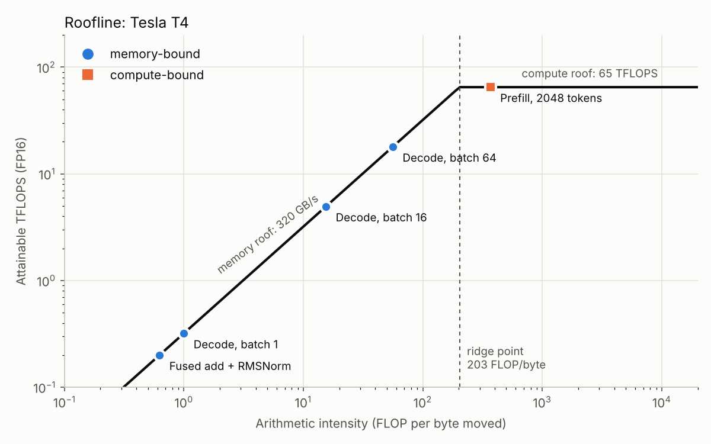

# Wattson

**How many joules did that LLM request cost?**

Wattson is a small Rust gateway that sits in front of an LLM inference server
(vLLM / SGLang) and attributes GPU energy and cost to each individual request,
using NVIDIA's NVML energy counters.

```
client  ->  wattson (:8080)  ->  vLLM / SGLang / mock server (:8000)
```

> Status: work in progress. Runs with a simulated GPU on any machine, and with
> real NVIDIA NVML readings on Linux (e.g. a free Kaggle T4).

## Layout

| Path | What it is |
|------|------------|
| `src/main.rs` | Gateway entry point and routes |
| `src/proxy.rs` | Forwards requests upstream, streams responses back, measures them |
| `src/attribution.rs` | Splits GPU energy fairly between concurrent requests |
| `src/energy.rs` | `EnergySource` trait, phase tracking, and the simulated GPU |
| `src/stats.rs` | In-memory per-request records and the `/stats` summary |
| `src/bin/mock-server.rs` | Fake OpenAI-compatible server for development without a GPU |
| `scripts/hf_server.py` | Baseline model server (Hugging Face transformers, one request at a time) |
| `scripts/load_test.py` | Benchmark at several concurrency levels; writes `results/<label>.csv` |
| `notebooks/wattson_kaggle.ipynb` | First real-GPU run: baseline server on a Kaggle T4 |
| `notebooks/wattson_vllm.ipynb` | Baseline vs vLLM, same GPU and model |
| `kernels/fused_add_rmsnorm.cu` | Fused residual-add + RMSNorm in CUDA (scalar and `half2`-vectorized) |
| `kernels/rmsnorm_triton.py` | The same kernel in Triton |
| `kernels/bench.py` | Correctness, time, bandwidth and energy: PyTorch vs CUDA vs Triton |
| `kernels/roofline.py` | Roofline model of the T4, applied to the measured decode speed |
| `notebooks/wattson_kernels.ipynb` | Runs the kernel benchmark on a Kaggle T4 |
| `results/` | Benchmark CSVs |

## What gets measured

For each request the gateway records:

- **completion tokens**: from the server's `usage` report when available
  (the gateway sets `stream_options.include_usage`), otherwise counted from
  the stream
- **time to first token (TTFT)**: roughly the *prefill* phase
- **decode throughput**: tokens per second after the first token
- **total latency**, and whether the client stayed until the end
- **energy (J) and joules per token**: the request's fair share of GPU
  energy (see below), plus the naive figure for comparison

### The simulated GPU

`SimulatedGpu` models a T4-class card (70 W limit) using the phase each
in-flight request is in:

| State | Power | Why |
|-------|-------|-----|
| idle | 18 W | baseline draw |
| any request prefilling | +40 W | prompt processing is compute-bound |
| N requests decoding | +30 W × (1 − 0.7ᴺ) | decode is memory-bound; batching adds little power per extra request |

### Fair attribution

The GPU reports a single number: total energy used so far. The naive way to
charge a request (counter at the end minus counter at the start) also charges
it for every other request running at the same time.

Instead, `attribution.rs` closes a time slice every 20 ms, and whenever a
request starts, changes phase or finishes. It splits the energy used in that
slice between the active requests, weighting prefill 4× decode. Energy used
with no requests running goes to an `idle` bucket. Every joule is counted
exactly once.

Results with the simulated GPU, 40-token requests:

| Scenario | Naive (per request) | Fair (per request) | J/token |
|----------|--------------------:|-------------------:|--------:|
| 1 request alone | 25.6 J | 25.6 J | 0.64 |
| 4 concurrent | 37.0 J | 9.3 J | 0.23 |

Naive attribution overcounted by 4× under concurrency. With fair attribution
the four requests add up to what the GPU actually used, and batching shows up
as a 2.8× drop in energy per token.

Check it yourself: `GET /energy` shows `ledger.attributed_j + ledger.idle_j`,
which tracks `total_energy_j`.

### Real GPUs: NVML

With `WATTSON_ENERGY=nvml` (Linux only), Wattson reads GPU energy through
NVML, the library behind `nvidia-smi`:

- **Volta and newer (T4, A100, ...)**: the GPU's own cumulative energy
  counter, in millijoules.
- **Older GPUs (P100)**: no counter, so Wattson samples power every 20 ms and
  integrates it.

NVML power readings are averaged by the driver, so very short requests are
measured less precisely than long ones.

### Queued requests

Until a request's first token arrives, the gateway can't tell whether it is
really prefilling or just waiting in the server's queue. On a server that
runs one request at a time, treating all of them as "prefill" overcharged
waiting requests heavily.

So Wattson polls the server's `/metrics` for `vllm:num_requests_waiting`
(vLLM publishes it; `scripts/hf_server.py` publishes the same metric). If N
of the M not-yet-started requests are waiting, each of the M gets
(M − N) / M of the prefill weight. Requests that arrive together can reach
the server in any order, so this splits fairly *on average* rather than
guessing which one started.

## Run on a free NVIDIA GPU (Kaggle)

1. Create a Kaggle notebook: **File → Import Notebook**, and upload
   `notebooks/wattson_vllm.ipynb`.
2. Settings: **Accelerator → GPU T4 x2**, **Internet → On**.
3. Run all cells. Results land in `/kaggle/working/wattson/results/`.

## Results on a Tesla T4

Same GPU (Kaggle Tesla T4), same model (Qwen2.5-0.5B-Instruct, FP16), same
benchmark: N simultaneous requests, 128 output tokens each, 3 rounds per
level. Energy from the T4's hardware energy counter via NVML, split per
request by Wattson. Data: `results/hf-t4.csv`, `results/vllm-t4.csv`.

| Concurrent requests | Baseline J/token | vLLM J/token | Baseline tok/s | vLLM tok/s |
|--------------------:|-----------------:|-------------:|---------------:|-----------:|
| 1  | 1.362 | 1.339 | 25.3 | 27.6 |
| 2  | 1.305 | 0.628 | 27.0 | 58.6 |
| 4  | 1.338 | 0.280 | 27.3 | 137.0 |
| 8  | –     | 0.246 | –    | 146.8 |
| 16 | –     | **0.101** | – | **461.6** |

Baseline = Hugging Face `transformers`, one request at a time. vLLM 0.18.0 =
continuous batching (Triton attention, eager mode).

### What the numbers say

- **Batching cuts energy per token 13×.** With a single request, vLLM is no
  better than the baseline: a 0.5B model generating one token at a time is
  bound by per-step overhead, not by the GPU. With 16 concurrent requests,
  vLLM reaches 461 tok/s at 0.10 J/token.
- **Extra requests are nearly free.** Each vLLM request decodes at ~33 tok/s
  whether 1 or 16 run together. A decode step reads all the weights from
  memory once regardless of batch size, so one step can serve many
  sequences at almost the same cost: decode is memory-bound, and batching
  amortizes the memory traffic.
- **The idle floor dominates small workloads.** The T4 draws ~27–31 W doing
  nothing. The serial baseline averaged ~34 W while generating, so ~80% of
  its energy was the idle floor. vLLM at 16 concurrent requests averaged
  ~47 W (0.101 J/token × 461.6 tok/s), still well under the 70 W limit.
- **The baseline doesn't scale.** More concurrent requests only add queueing:
  mean time to first token rose from 0.4 s to 7.2 s while throughput stayed
  flat at ~27 tok/s.
- **Reproducible.** Two separate baseline runs (`hf-serial-t4.csv` and
  `hf-t4.csv`, different sessions) agree within ~4% on J/token.

### Anomaly: concurrency 8

At 8 concurrent requests vLLM's mean TTFT was 2,957 ms and throughput only
147 tok/s, worse than at 16. The likely cause is one-time warm-up: Triton
kernels are compiled the first time they see a new batch shape, and the first
round at that level paid for it. `load_test.py` now runs an unrecorded
warm-up round per level (`--warmup`, default 1) to keep this out of the
measurements.

## Roofline: why is decode slow?



A kernel is capped by compute (65 TFLOPS FP16 on the T4) or by memory
bandwidth (320 GB/s), depending on its *arithmetic intensity*: FLOPs per byte
moved. The ridge point is 65e12 / 320e9 ≈ **203 FLOP/byte**.

- **Decode is memory-bound.** A linear layer applied to a batch of B tokens
  reads every weight once and does ~B FLOPs per byte, so decode sits far
  left of the ridge until the batch reaches ~200. That is why adding
  sequences to a batch costs almost nothing.
- **Prefill is compute-bound.** 2048 prompt tokens give ~370 FLOP/byte,
  past the ridge.
- **RMSNorm is extremely memory-bound** (~0.6 FLOP/byte), so its only
  possible optimization is moving fewer bytes, which is what fusion does.

**The measured decode speed is 10× slower than the memory roof.** Each decode
step of Qwen2.5-0.5B must read 0.99 GB of weights, so at 320 GB/s a step takes
at least 3.1 ms (≤ 324 tokens/s per sequence). vLLM measured ~32 tokens/s per
sequence, about 31 ms per step, at *every* batch size from 1 to 16. So the
bottleneck is neither compute nor memory: it's the fixed cost of launching
hundreds of small kernels per step in eager mode. Batching shares that fixed
cost across sequences, which is exactly why energy per token fell 13× while
per-sequence speed stayed flat. (Next experiment: CUDA graphs, i.e. vLLM
without `--enforce-eager`, which remove most of that launch overhead.)

## GPU kernel: fused residual-add + RMSNorm

Every Llama/Qwen block runs `h = x + residual; out = RMSNorm(h) * weight`
twice per layer. PyTorch eager runs it as ~6 kernels, each a full pass over
GPU memory. Fused, each element is read once and written once. Since the
kernel is memory-bound, the score that matters is **achieved bandwidth as a
percentage of the 320 GB/s peak**.

Implementations compared in `kernels/bench.py`:

| Name | What it is |
|------|------------|
| `pytorch-eager` | The naive PyTorch expression (several kernels) |
| `pytorch-rms_norm` | Separate add, then PyTorch's built-in `F.rms_norm` |
| `cuda-scalar` | Hand-written CUDA, one fp16 value per load, warp-shuffle reduction |
| `cuda-half2` | Same, but loads two fp16 values per instruction |
| `triton` | Triton version; the compiler picks vectorization and layout |

Results on a Tesla T4: *(run `notebooks/wattson_kernels.ipynb`)*

## Try it

Terminal 1, the fake inference server:
```bash
cargo run --bin mock-server
```

Terminal 2, the gateway:
```bash
cargo run --bin wattson
```

Terminal 3, send a request through the gateway, then look at the stats:
```bash
curl -N localhost:8080/v1/chat/completions \
  -H 'Content-Type: application/json' \
  -d '{"stream":true,"max_tokens":20,"messages":[{"role":"user","content":"hi"}]}'

curl localhost:8080/stats
curl localhost:8080/energy
```

## Configuration

| Variable | Default | |
|----------|---------|--|
| `WATTSON_PORT` | `8080` | Gateway port |
| `WATTSON_UPSTREAM` | `http://127.0.0.1:8000` | Inference server base URL |
| `WATTSON_ENERGY` | `sim` | Energy source: `sim` or `nvml` (Linux + NVIDIA GPU) |
| `WATTSON_GPU_INDEX` | `0` | Which GPU NVML reads |
| `MOCK_PREFILL_MS` | `50` | Mock server delay before the first token |
| `MOCK_TOKEN_DELAY_MS` | `20` | Mock server delay per generated token |
| `MOCK_PORT` | `8000` | Mock server port |
